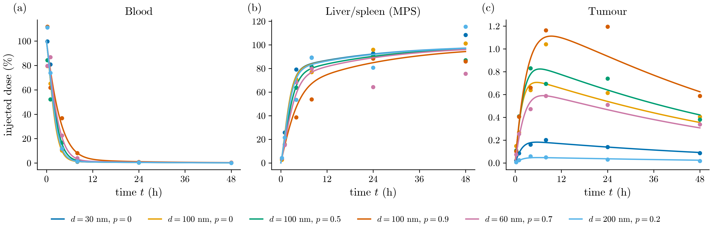
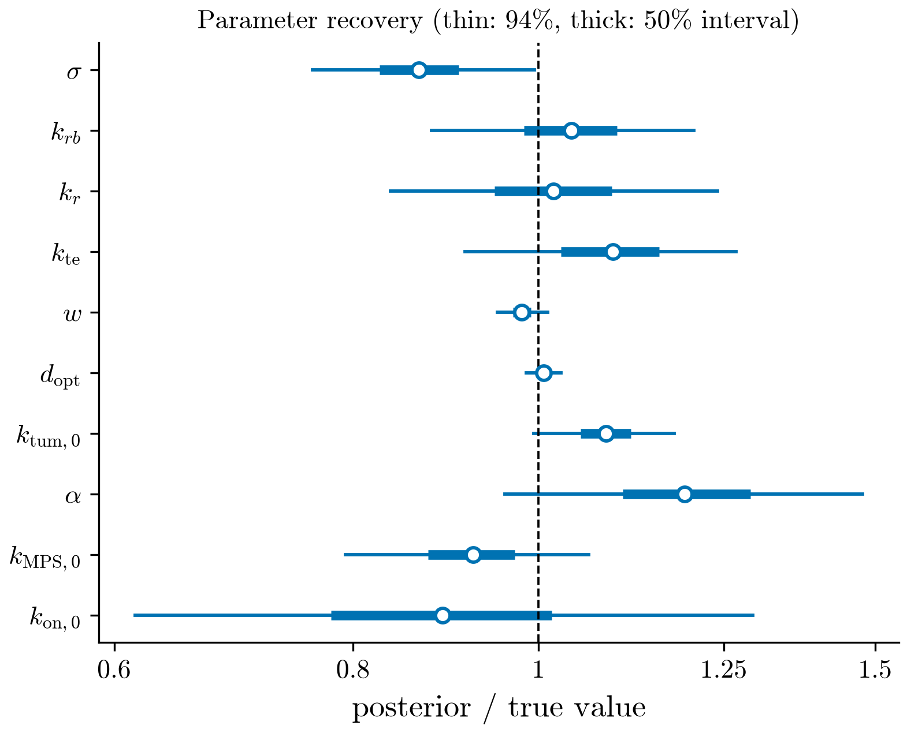
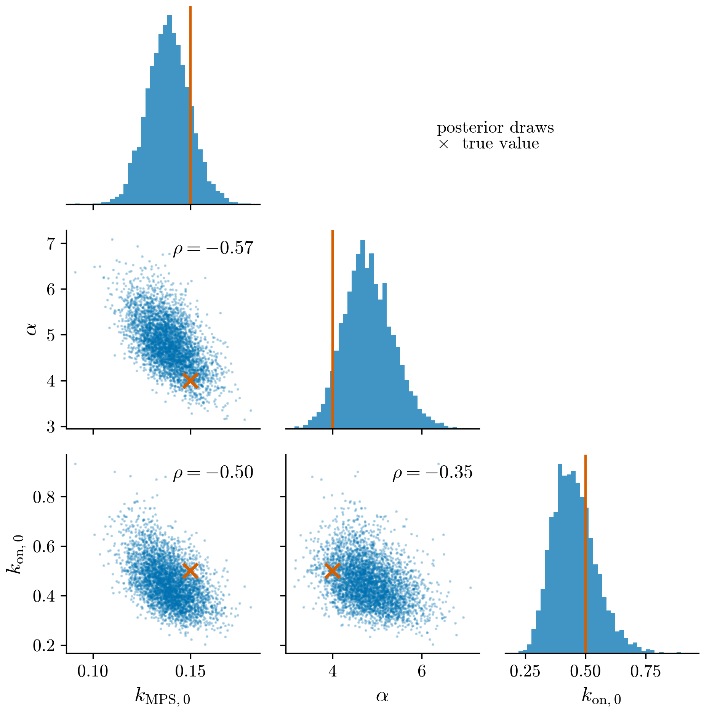
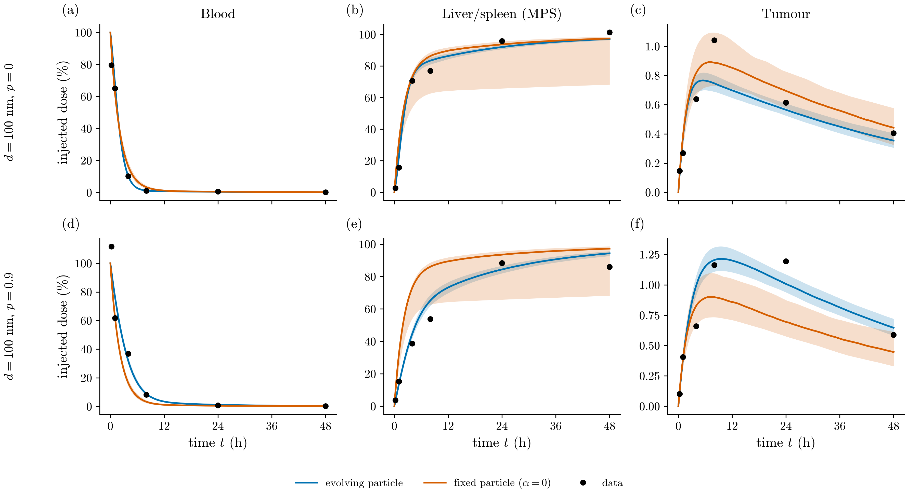
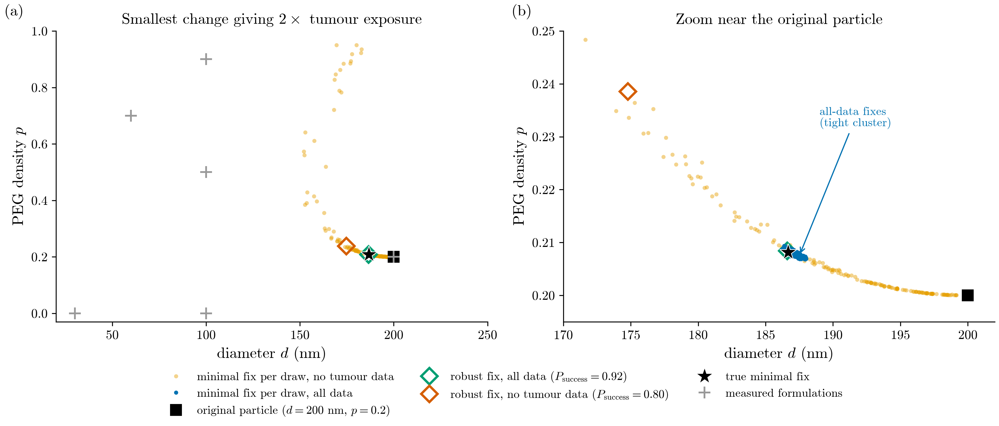
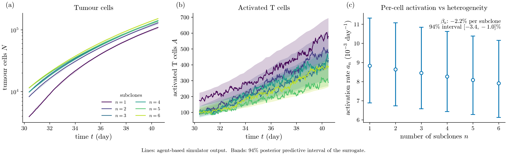
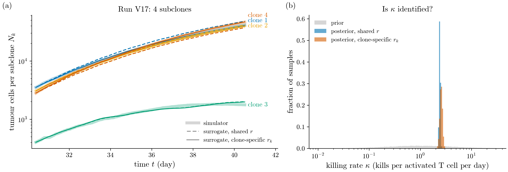

# npcb — Bayesian calibration of nanoparticle transport with an evolving particle

A minimal physiologically based model of nanoparticle delivery to a tumour in which the particle **changes in
transit** (protein corona formation accelerates its clearance), calibrated with Bayesian inference in PyMC, compared
against a fixed-particle model, and used to answer a counterfactual design question:

> For a particle that reaches the tumour poorly, what is the smallest change in its properties that fixes it,
> and when should that answer not be trusted?

The same workflow is then applied to the output of my M.Sc. agent-based tumour–immune model, as a cheap Bayesian
ODE surrogate of an expensive simulator.

The nanoparticle data are **synthetic**, generated from the model with known parameters, so that every inference
step can be checked against the truth. The tumour–immune data are real output of my own simulator, not experiments.

---

## Contents

1. [Model](#1-model)
2. [Bayesian calibration](#2-bayesian-calibration)
3. [Does it matter that the particle changes?](#3-does-it-matter-that-the-particle-changes)
4. [Counterfactual: the smallest fix, and when not to trust it](#4-counterfactual-the-smallest-fix-and-when-not-to-trust-it)
5. [Surrogate of an agent-based tumour–immune model](#5-surrogate-of-an-agent-based-tumourimmune-model)
6. [Biological basis and assumptions](#6-biological-basis-and-assumptions)
7. [Limitations](#7-limitations)
8. [Running the code](#8-running-the-code)

---

## 1. Model

State: corona coverage `c ∈ [0, 1]` and the fraction of the injected dose in blood `B`, liver/spleen (mononuclear
phagocyte system) `L`, tumour `T` and rest of body `R`. Time in hours.

```
dc/dt = k_on (1 - c)                                     corona formation
dB/dt = -(k_mps(c) + k_tum + k_r) B + k_rb R + k_te T
dL/dt =  k_mps(c) B                                      MPS sequestration (irreversible)
dT/dt =  k_tum B - k_te T                                tumour uptake and washout
dR/dt =  k_r B - k_rb R

k_mps(c) = k_mps0 (1 + alpha c)                          opsonised particles are cleared faster
k_on     = k_on0 (1 - p)                                 PEG density p slows corona formation
k_tum    = k_tum0 exp(-((d - d_opt) / w)^2)              size window for extravasation, diameter d
```

`B + L + T + R = 1` at all times (tested). Setting `alpha = 0` gives the conventional **fixed-particle** model.

Six formulations (diameter, PEG density) are simulated and sampled at 0.25, 1, 4, 8, 24 and 48 h in blood, liver and
tumour with 20 % log-normal noise (108 observations). With the chosen parameters, peak tumour delivery of a 100 nm
bare particle is about 0.7 % of the injected dose, consistent with the median reported by Wilhelm et al. (2016).



## 2. Bayesian calibration

- **Priors:** log-normal on all rate constants, centred on order-of-magnitude values that are deliberately not the
  true ones (log-sd 1, i.e. roughly a factor of 3 either way); `d_opt ~ Normal(100, 40)` nm.
- **Likelihood:** `log(observed) ~ Normal(log(predicted), sigma)`, with `sigma` inferred.
- **ODE solver inside the model:** fixed-step RK4 (0.05 h) written in PyTensor (`pytensor.scan`), all formulations
  solved together, so NUTS gets exact gradients through the solver.
- **Sampler:** NUTS via NumPyro/JAX (`nuts_sampler="numpyro"`), 4 chains × 1000 draws after 1000 tuning steps,
  about 2 minutes on a laptop CPU.

Diagnostics: R-hat = 1.00 for every parameter, bulk ESS 2 400–3 700, no divergences. All 94 % posterior intervals
contain the true value:



The posterior shows a clear trade-off between the base MPS uptake `k_mps0`, the corona effect `alpha` and the corona
formation rate `k_on0`: from blood and liver data alone, *slow clearance with a strong corona effect* is hard to
distinguish from *faster clearance with a weak one*. These are the least certain parameters. A direct measurement of
corona coverage would break the trade-off.



## 3. Does it matter that the particle changes?

The fixed-particle model (`alpha = 0`) was fitted to the same data and compared by PSIS-LOO cross-validation:

| model | elpd (LOO) | Δelpd | inferred noise `sigma` |
|---|---|---|---|
| evolving particle | 30.0 | 0 | 0.17 |
| fixed particle | −70.0 | −100 ± 11 | 0.42 |

The fixed model needs more than twice the true measurement noise to explain the data. It cannot represent the
effect of PEG (without a corona, PEG has nothing to act on), so it clears PEGylated particles too fast and
under-predicts their tumour delivery by about 25 %:



The fixed-model posterior also samples poorly (R-hat 1.03 and ESS ≈ 150 for `k_mps0`, `k_r`, `k_rb`): a misspecified
model forced onto the data produces an awkward, elongated posterior. Its `k_on0` posterior equals the prior, since
the parameter no longer enters the likelihood.

## 4. Counterfactual: the smallest fix, and when not to trust it

The 200 nm, PEG 0.2 formulation reaches the tumour poorly (tumour AUC about 4 % of the best formulation). For each of
200 posterior draws, `scipy.optimize` (SLSQP, multi-start) finds the smallest change

```
min (Δd / 50 nm)^2 + (Δp / 0.5)^2    subject to    tumour AUC(0–48 h) ≥ 2 × baseline
```

which gives a **distribution** of minimal fixes rather than a single answer. Three trust checks:

1. **Success probability** of the recommended design across the whole posterior.
2. **Extrapolation:** distance from the recommendation to the nearest measured formulation.
3. **Data dependence:** the whole analysis repeated after refitting without the tumour measurements.

A **robust fix** is also computed: the smallest change that meets the target under 90 % of the posterior draws.

| | median minimal fix | its success probability | robust fix | its success probability |
|---|---|---|---|---|
| all data | 187.2 nm, PEG 0.21 | 0.50 | 186.6 nm, PEG 0.21 | 0.92 |
| without tumour data | 189.8 nm, PEG 0.20 | 0.50 | 174.8 nm, PEG 0.24 | 0.80 |
| true minimal fix | 186.7 nm, PEG 0.21 | | | |



- A minimal fix lies on the success boundary by construction, so under any uncertainty it works only about half the
  time. The point estimate is correct but should not be handed to an experimentalist as it is.
- With all data the posterior is tight: going from 50 % to 92 % success costs 0.6 nm.
- Without tumour data the median fix barely moves, but the distribution of fixes spreads from "shrink slightly" to
  "shrink to 155 nm" to "add much more PEG", and the robust fix needs a change four times larger. The robust fix
  there was optimised on 50 draws and reaches only 80 % on all 200, a small case of overfitting to the draws used.
- The size of the safety margin needed is itself a measure of how far the counterfactual can be trusted.

## 5. Surrogate of an agent-based tumour–immune model

My M.Sc. thesis (Sharif University of Technology) uses a 3D hybrid agent-based model of the tumour–immune
microenvironment in MATLAB: angiogenesis and vascular flow, interstitial (Darcy) flow, reaction–diffusion of oxygen,
glucose, VEGF, chemokines and IL-2, and individual tumour cells and T cells, on a 10 mm domain with a 50 µm lattice.
One run takes several days. Tumours with 1–6 antigenically distinct subclones are simulated for about 40 days.

The surrogates below are fitted with the same PyMC workflow to **saved simulator output**; the simulator itself is
not run here.

### 5a. Bulk counts, 1–6 subclones

Late, vascularised phase (day ≈ 30 to 40.5), all six heterogeneity levels fitted jointly:

```
dN/dt = r_n N ln(K_n / N) - kappa A          Gompertz growth minus T-cell killing
dA/dt = a_n T(t) - delta A                    activation of the T cells present; T(t) from the simulator
log a_n = mu_a + beta_a (n - 1)               n = number of subclones
```

R-hat 1.00, no divergences; Gompertz fits tumour growth to within about 1.5 %.

- With more subclones, activated T cells fall by about a third (≈ 580 → 390). The posterior separates two causes:
  per-cell activation declines by **2.2 % per extra subclone** (94 % interval 1.0–3.4 %, P(decline) = 0.999),
  i.e. about 10 % from 1 to 6 subclones. Most of the drop therefore comes from **fewer T cells being present**,
  not from less effective activation.
- The killing rate `kappa` is **not identifiable** from bulk counts: a few hundred activated T cells against
  ~10⁵ tumour cells leave no visible trace in the totals. The posterior only gives an upper bound.



### 5b. Per subclone: killing becomes identifiable

Single runs with per-subclone counters (V17: 4 subclones, V16: 2 subclones):

```
dN_k/dt = r_k N_k ln(K / Σ_j N_j) - kappa A_k(t)      A_k(t): activated T cells specific to clone k
```

fitted with one shared growth rate, and with clone-specific growth rates under partial pooling
(`log r_k ~ Normal(mu_r, tau_r)`, non-centred). The second version lets a clone simply grow slower instead of being
killed, which is the test of whether `kappa` is really identified.

In V17 one subclone stays about 25 times smaller than its siblings while facing a similar number of specific T cells.

| run | model | `kappa` [kills / activated T cell / day], 94 % interval | LOO |
|---|---|---|---|
| V17 | shared growth | 2.40 (2.29–2.51) | |
| V17 | per-clone growth | **2.56 (2.27–2.83)** | better by 170 ± 17 |
| V16 | shared growth | 5.09 (4.74–5.40) | |
| V16 | per-clone growth | 3.23 (0.96–4.95) | indistinguishable |



- **V17:** `kappa` survives when each clone may have its own growth rate, and the small clone's growth rate (0.118/day)
  is no lower than its siblings' (0.109–0.126/day). That subclone is held back by killing, not by slow growth.
- **V16:** both clones grow large; killing and slightly slower intrinsic growth explain the data equally well, and
  `kappa` is only weakly constrained. Same identifiability lesson as `k_mps0` vs `alpha` in Section 2.

## 6. Biological basis and assumptions

| model element | mechanism | reference | simplification here |
|---|---|---|---|
| `dc/dt = k_on (1 - c)` | Plasma proteins adsorb on particles within minutes, forming a protein corona | Cedervall et al., *PNAS* 2007; Monopoli et al., *Nat. Nanotechnol.* 2012 | One first-order process. Real coronas evolve: abundant, fast-binding proteins are replaced by higher-affinity ones (Vroman effect) |
| `k_mps = k_mps0 (1 + alpha c)` | Opsonins in the corona (complement, IgG) trigger uptake by liver and spleen macrophages | Tsoi et al., *Nat. Mater.* 2016 | Linear in coverage; corona composition, not only coverage, matters in reality |
| `k_on = k_on0 (1 - p)` | PEG coating reduces protein adsorption and prolongs circulation | Standard "stealth" design, e.g. PEGylated liposomal doxorubicin | Linear; ignores anti-PEG antibodies and accelerated blood clearance |
| Gaussian size window in `k_tum` | Leaky tumour vasculature favours roughly 30–200 nm particles (EPR effect); small particles are filtered renally, large ones by the spleen | Wilhelm et al., *Nat. Rev. Mater.* 2016 | Gaussian shape is a convenience, not a measured curve; EPR is heterogeneous between tumours and patients |
| Four compartments | Minimal PBPK structure | | Full PBPK models have 10–20 organs; no kidney clearance, no aggregation or degradation, no vascular–interstitial exchange |
| Parameter values | | | Chosen so outputs fall in realistic ranges (≈ 90 % MPS, < 1 % tumour), not fitted to a specific dataset |

## 7. Limitations

- **Synthetic data (Sections 1–4).** They come from the same model family that is fitted, so the fixed-vs-evolving
  comparison shows the method works when the true structure is known, not that real particles follow this model.
- **Counterfactual cost function.** Treating 50 nm of diameter as equivalent to 0.5 PEG density is a choice; the
  recommendation moves if the relative cost of changing size and surface chemistry changes.
- **Simulator data are replicate averages or single runs (Section 5).** Neighbouring time points are strongly
  autocorrelated while the likelihood treats them as independent, so posterior intervals are too narrow. The per-clone results come from single runs, so run-to-run variability
  in `kappa` cannot be separated from real differences.
- **Fitting window.** Only the late, vascularised phase (≈ day 30 onward) is modelled; the avascular plateau and the
  angiogenic growth switch are not.
- **Killing events are not observed directly.** The simulator counts T-cell kills internally but does not save them;
  saving them would identify `kappa` without relying on a controlled subclone.

## 8. Running the code

Python ≥ 3.11.

```bash
python -m venv .venv
.venv\Scripts\activate          # Windows; on Linux/macOS: source .venv/bin/activate
pip install -e ".[dev]"
pytest -q                       # model tests: mass conservation, corona dynamics, solver agreement
```

The NUTS sampler runs through NumPyro/JAX, so no C++ compiler is needed for PyTensor.

The analysis scripts compute and save results in `data/`; `scripts/make_figures.py` draws every figure from those
saved results in seconds (PNG at 300 dpi and vector PDF in `figures/`). Posterior files (`data/*.nc`) are not
tracked in git; run scripts 02–06 once before `make_figures.py`.

| script | what it does | time |
|---|---|---|
| `scripts/01_simulate.py` | synthetic data and ground truth | seconds |
| `scripts/02_calibrate.py` | Bayesian calibration of the evolving-particle model | ~2 min |
| `scripts/03_fixed_vs_evolving.py` | fixed-particle fit and LOO comparison | ~2 min |
| `scripts/04_counterfactual.py` | minimal and robust fixes, refit without tumour data | ~15 min |
| `scripts/05_thesis_surrogate.py` | bulk surrogate of the agent-based model, 1–6 subclones | ~3 min |
| `scripts/06_thesis_per_clone.py <run Data folder>` | per-subclone killing model for one run | ~4 min |
| `scripts/make_figures.py [1 2 ...]` | all figures, or the listed ones | seconds |

```
src/npcb/
  model.py           ODE, property-to-rate maps, SciPy and RK4 solvers, tumour AUC
  simulate.py        synthetic formulations, noise model, data I/O
  inference.py       PyMC model with the ODE solved in PyTensor
  counterfactual.py  minimal and robust fixes, trust checks
  thesis.py          surrogates of the agent-based tumour–immune model
  plotstyle.py       shared figure style (Computer Modern, colour-blind-safe palette)
tests/test_model.py
data/                synthetic data, ground truth, posteriors, simulator output (data/thesis_abm)
figures/
```

`scripts/06_thesis_per_clone.py` reads `FinalResults.mat` from a simulator run folder, which is not included in this
repository; the per-clone counts it extracts are saved in `data/thesis_abm/` so the figures can be redrawn without it.

## References

- Cedervall T. et al. (2007) Understanding the nanoparticle–protein corona using methods to quantify exchange rates
  and affinities of proteins for nanoparticles. *PNAS* 104, 2050–2055.
- Monopoli M. P. et al. (2012) Biomolecular coronas provide the biological identity of nanosized materials.
  *Nature Nanotechnology* 7, 779–786.
- Tsoi K. M. et al. (2016) Mechanism of hard-nanomaterial clearance by the liver. *Nature Materials* 15, 1212–1221.
- Wilhelm S. et al. (2016) Analysis of nanoparticle delivery to tumours. *Nature Reviews Materials* 1, 16014.
- Vehtari A., Gelman A., Gabry J. (2017) Practical Bayesian model evaluation using leave-one-out cross-validation
  and WAIC. *Statistics and Computing* 27, 1413–1432.

## License

MIT
